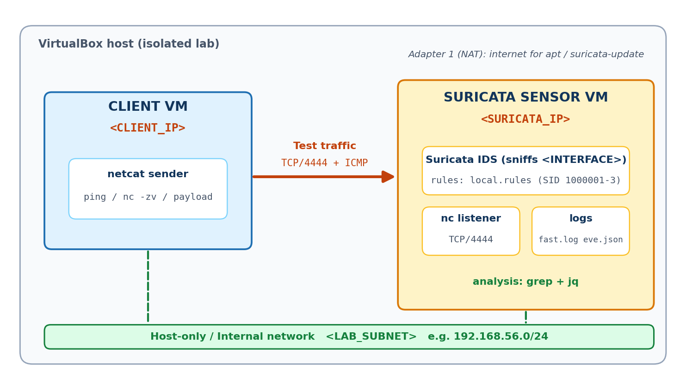

# Suricata IDS Practical Lab Manual

## 1. Lab Overview and Learning Objectives

### 1.1 What is this lab about?

**Suricata** is an open-source network threat detection engine. It can work as an **Intrusion Detection System (IDS)**, which watches network traffic and raises alerts, or as an **Intrusion Prevention System (IPS)**, which can also block traffic. In this lab you use Suricata in **IDS mode**: it only observes and alerts.

You will write your own detection rule, generate harmless test traffic with **netcat**, and then investigate the resulting alerts in the same way a **Security Operations Center (SOC)** analyst would, using `fast.log`, `eve.json`, `grep` and `jq`.

> **Warning:** Authorized use only. Run this lab only on virtual machines and networks that you own or are explicitly authorized to test. Never point the traffic scripts at systems you do not control.

### 1.2 Learning objectives

By the end of this lab you will be able to:

- Install Suricata and the supporting tools (`jq`, `netcat`) on a Linux VM.
- Identify the correct network interface and IP addresses with `ip`.
- Configure `HOME_NET`, the capture interface and the rule files in `suricata.yaml`.
- Write, load and validate a custom Suricata detection rule.
- Generate controlled test traffic with netcat.
- Start Suricata in IDS mode and confirm that it is capturing traffic.
- Read alerts in `fast.log` and structured events in `eve.json`.
- Filter and summarize alerts with `grep` and `jq`.
- Troubleshoot common failures: *No route to host*, *Connection refused*, wrong interface and missing alerts.

### 1.3 Lab summary

| Item | Details |
|---|---|
| Difficulty | Beginner |
| Estimated time | 90 to 120 minutes |
| Tools | Suricata 6.x or 7.x, netcat, jq, grep, ip |
| Skills practiced | IDS deployment, rule writing, traffic generation, log analysis |
| Environment | Two Linux VMs on an isolated host-only network (one-VM option included) |

## 2. Lab Environment and Network Topology

### 2.1 Topology



Two VMs share an isolated **host-only** (or internal) network. The **Client VM** generates traffic. The **Suricata Sensor VM** receives the traffic, runs the netcat listener, and inspects every packet on its lab interface.

| Role | Hostname (example) | IP address | Purpose |
|---|---|---|---|
| Suricata Sensor VM | `sensor` | `<SURICATA_IP>` | Runs Suricata and the netcat listener |
| Client VM | `client` | `<CLIENT_IP>` | Sends test traffic with netcat |
| Lab subnet | n/a | `<LAB_SUBNET>` | For example `192.168.56.0/24` |
| Sensor capture interface | n/a | `<INTERFACE>` | For example `enp0s8` or `eth1` |

> **Note:** Example values used in this manual: `<SURICATA_IP>` = 192.168.56.10, `<CLIENT_IP>` = 192.168.56.20, `<LAB_SUBNET>` = 192.168.56.0/24, `<INTERFACE>` = enp0s8. Your values will differ. Replace every placeholder in angle brackets before running a command.

### 2.2 VirtualBox network setup

1. Power off both VMs.
2. In VirtualBox open **Settings > Network** for each VM.
3. Keep **Adapter 1** as **NAT** (gives internet access for installing packages).
4. Enable **Adapter 2**, set it to **Host-only Adapter** (or **Internal Network** named `suricata-lab`).
5. Start both VMs and confirm each one has an address on the same subnet (Section 5).

### 2.3 One-VM option (loopback)

If you only have one VM, you can run everything on it: use the loopback interface `lo` as `<INTERFACE>`, use `127.0.0.1` as `<SURICATA_IP>`, and run the client commands from a second terminal. The lab then works the same way, but there is no real network between client and sensor.

## 3. Prerequisites

### 3.1 Knowledge

- Basic Linux command line (cd, ls, cat, nano).
- Basic networking: IP addresses, subnets, TCP ports.
- No prior Suricata experience is needed.

### 3.2 Software and access

| Requirement | Notes |
|---|---|
| Two Linux VMs (Ubuntu 22.04 or similar) | Sensor and Client. Kali or Debian also work. |
| `sudo` access | You need administrator rights on the sensor. |
| Internet access on the sensor (NAT) | Needed once to install packages. |
| Terminal access | You will use three terminals on the sensor and one on the client. |

> **Tip:** If you use the Cisco NetAcad Cybersecurity LabVM as your sensor, make sure the VM has a working sudo password and a second network adapter as described in Section 2.2.

### 3.3 Terminal layout

| Terminal | Machine | Used for |
|---|---|---|
| Terminal A | Sensor | Running Suricata (stays open) |
| Terminal B | Sensor | Netcat listener |
| Terminal C | Sensor | Watching and analyzing logs |
| Terminal D | Client | Generating traffic |

## 4. Step-by-Step Suricata Installation and Configuration

All commands in this section run on the **Sensor VM**.

### 4.1 Download the lab files

```bash
git clone https://github.com/<YOUR_GITHUB_USERNAME>/suricata-ids-lab.git
cd suricata-ids-lab
```

If you downloaded the ZIP instead, unzip it and `cd` into the folder.

### 4.2 Install Suricata and tools

```bash
sudo apt update
sudo apt install -y suricata jq netcat-openbsd
```

*Optional (Ubuntu only):* install a newer Suricata from the official OISF PPA before the install command above.

```bash
sudo apt install -y software-properties-common
sudo add-apt-repository -y ppa:oisf/suricata-stable
sudo apt update
```

Verify the installation:

```bash
suricata -V
```

Expected output (version will vary):

```output
This is Suricata version 6.0.10 RELEASE
```

**What it means:** Suricata is installed and on your PATH. If you see `command not found`, the install failed. Re-run the install and read the error messages.

> **Note:** The helper script `scripts/install_suricata.sh` performs Sections 4.2, 4.5 and 4.6 for you. Reading the manual steps first is better for learning.

### 4.3 Stop the automatic service

The package may start Suricata automatically on a default interface. Stop it so it does not conflict with your manual runs:

```bash
sudo systemctl stop suricata
sudo systemctl status suricata --no-pager | head -n 5
```

Expected output:

```output
○ suricata.service - Suricata IDS/IDPS
     Loaded: loaded (/lib/systemd/system/suricata.service; enabled; ...)
     Active: inactive (dead)
```

**What it means:** `inactive (dead)` confirms the background service is stopped.

### 4.4 Back up the configuration

```bash
sudo cp /etc/suricata/suricata.yaml /etc/suricata/suricata.yaml.bak
```

There is no output when this succeeds. The backup lets you roll back if you break the YAML file.

### 4.5 Download the standard rule set (optional but recommended)

```bash
sudo suricata-update
```

Expected output (shortened):

```output
Loading /etc/suricata/suricata.yaml
Downloading https://rules.emergingthreats.net/open/suricata-6.0.10/emerging.rules.tar.gz
...
Done.
```

**What it means:** The free Emerging Threats Open rules were saved to `/var/lib/suricata/rules/suricata.rules`. This needs internet. **If you are offline**, skip this step and remove the `suricata.rules` line from `rule-files` in Section 4.7.

### 4.6 Install the lab rule file

```bash
sudo cp rules/local.rules /var/lib/suricata/rules/local.rules
ls -l /var/lib/suricata/rules/local.rules
```

Expected output:

```output
-rw-r--r-- 1 root root 1623 Oct  5 14:10 /var/lib/suricata/rules/local.rules
```

**What it means:** The file exists where Suricata looks for rules. The size will differ slightly.

### 4.7 Edit suricata.yaml

Open the configuration file:

```bash
sudo nano /etc/suricata/suricata.yaml
```

> **Tip:** In nano, press `Ctrl+W` to search. Press `Ctrl+O` then Enter to save, and `Ctrl+X` to exit. YAML uses **spaces, never tabs**, and indentation matters.

Make these three changes. A reference excerpt is in `config/suricata.yaml.example`.

**Change 1: HOME_NET.** Search for `HOME_NET:` and set it to your lab subnet:

```yaml
vars:
  address-groups:
    HOME_NET: "[<LAB_SUBNET>]"
```

**Change 2: capture interface.** Search for `af-packet:` and set the first interface to your capture interface (found in Section 5):

```yaml
af-packet:
  - interface: <INTERFACE>
```

**Change 3: rule files.** Search for `rule-files:` and make sure both files are listed:

```yaml
default-rule-path: /var/lib/suricata/rules
rule-files:
  - suricata.rules
  - local.rules
```

Also confirm that `fast` and `eve-log` are enabled under `outputs:` (they are by default):

```bash
sudo grep -n -A3 -E "^\s+- (fast|eve-log):" /etc/suricata/suricata.yaml | head -n 12
```

Expected output (line numbers will vary):

```output
231:  - fast:
232-      enabled: yes
233-      filename: fast.log
...
```

**What it means:** `enabled: yes` under both `fast` and `eve-log` means alerts will be written to `fast.log` and `eve.json`.

### 4.8 Validate the configuration

```bash
sudo suricata -T -c /etc/suricata/suricata.yaml -v
```

Expected output (shortened, numbers vary):

```output
Notice: suricata: This is Suricata version 6.0.10 RELEASE running in SYSTEM mode
Info: conf: Running suricata under test mode
Info: detect: 3 rule files processed. 35412 rules successfully loaded, 0 rules failed
Notice: suricata: Configuration provided was successfully loaded. Exiting.
```

**What it means:** `-T` tests the configuration without starting capture. Look for **`0 rules failed`** and **`successfully loaded`**. If you see `rules failed`, scroll up for the line naming the file and line number of the bad rule.

## 5. Network Interface Identification

Suricata must listen on the interface that actually carries the lab traffic. The wrong interface is the most common cause of "no alerts".

### 5.1 List interfaces and addresses

Run this on **both VMs**:

```bash
ip -br a
```

Expected output on the sensor:

```output
lo               UNKNOWN        127.0.0.1/8 ::1/128
enp0s3           UP             10.0.2.15/24
enp0s8           UP             192.168.56.10/24
```

**What it means:**

- `lo` is the loopback interface (traffic inside the same VM).
- `enp0s3` has `10.0.2.15`, the **NAT** adapter used for internet access.
- `enp0s8` has `192.168.56.10`, the **host-only** lab adapter. Here `<INTERFACE>` is `enp0s8`, `<SURICATA_IP>` is `192.168.56.10` and `<LAB_SUBNET>` is `192.168.56.0/24`.

Your interface names may be `eth0`, `eth1`, `ens33` and so on. Pick the one whose address is in the **lab subnet**, not the NAT address.

### 5.2 Confirm the route to the lab subnet

```bash
ip route
```

Expected output:

```output
default via 10.0.2.2 dev enp0s3 proto dhcp src 10.0.2.15 metric 100
10.0.2.0/24 dev enp0s3 proto kernel scope link src 10.0.2.15
192.168.56.0/24 dev enp0s8 proto kernel scope link src 192.168.56.10
```

**What it means:** The line for `192.168.56.0/24` shows which interface (`dev enp0s8`) reaches the lab network. That is your `<INTERFACE>`.

### 5.3 Test connectivity from the client

On the **Client VM** (use your own `<SURICATA_IP>`):

```bash
ping -c 3 <SURICATA_IP>
```

Expected output:

```output
PING 192.168.56.10 (192.168.56.10) 56(84) bytes of data.
64 bytes from 192.168.56.10: icmp_seq=1 ttl=64 time=0.412 ms
...
3 packets transmitted, 3 received, 0% packet loss
```

**What it means:** `0% packet loss` proves the two VMs can reach each other. If this fails, fix networking (Section 12) before continuing.

## 6. Custom Suricata Detection Rule

### 6.1 Rule anatomy

A Suricata rule has a **header** (what traffic to look at) and **options** (what to look for and what to log).

```text
alert tcp any any -> any 4444 (msg:"..."; content:"..."; sid:1000002; rev:1;)
|     |   |   |      |   |    |
|     |   |   |      |   |    +-- options in parentheses
|     |   |   |      |   +------- destination port
|     |   |   |      +----------- destination IP
|     |   |   +------------------ source port
|     |   +---------------------- source IP
|     +-------------------------- protocol
+-------------------------------- action
```

### 6.2 The lab rules

The file `rules/local.rules` contains three rules:

```text
alert tcp any any -> any 4444 (msg:"LAB Netcat - TCP connection attempt to port 4444"; flags:S; classtype:misc-activity; sid:1000001; rev:1;)

alert tcp any any -> any 4444 (msg:"LAB Netcat - Marker string SURICATA-LAB-TEST in payload"; flow:to_server,established; content:"SURICATA-LAB-TEST"; nocase; classtype:trojan-activity; sid:1000002; rev:1;)

alert icmp any any -> any any (msg:"LAB ICMP - Echo request (ping) detected"; itype:8; classtype:misc-activity; sid:1000003; rev:1;)
```

| Option | Meaning |
|---|---|
| `msg` | Text shown in the alert. |
| `flags:S` | Match packets with the TCP SYN flag (a connection attempt). |
| `flow:to_server,established` | Match only client-to-server traffic on an established connection. |
| `content:"..."` | Search the payload for this exact text. |
| `nocase` | Ignore upper/lower case when matching content. |
| `itype:8` | ICMP type 8 = echo request (ping). |
| `classtype` | Category used for the alert's classification and priority. |
| `sid` | Unique rule ID. 1000000 to 1999999 is reserved for local rules. |
| `rev` | Revision number. Increase it each time you edit the rule. |

> **Note:** The lab rules use `any` for addresses so they work in every topology, including loopback. In a real network you would restrict them with variables such as `$EXTERNAL_NET -> $HOME_NET`. You will practice this in the challenge in Section 14.

### 6.3 Reload rules after editing

If you change a rule while Suricata is running, copy the file again and reload:

```bash
sudo cp rules/local.rules /var/lib/suricata/rules/local.rules
sudo kill -USR2 $(pidof suricata)
```

There is no output. Suricata re-reads its rules live. Check `/var/log/suricata/suricata.log` to confirm.

## 7. Netcat Traffic Generation

**Netcat** (`nc`) is a simple tool that opens TCP/UDP connections. It plays two roles in this lab:

| Role | Machine | Command |
|---|---|---|
| Listener (server) | Sensor | `nc -lvnp 4444` |
| Sender (client) | Client | `printf 'SURICATA-LAB-TEST\n' \| nc -w 3 <SURICATA_IP> 4444` |

### 7.1 Start the listener (Terminal B, Sensor)

```bash
nc -lvnp 4444
```

Expected output:

```output
Listening on 0.0.0.0 4444
```

**What it means:** The sensor is waiting for a TCP connection on port 4444. The flags are `-l` listen, `-v` verbose, `-n` no DNS lookups, `-p` port.

> **Warning:** A plain `nc -l` listener accepts **one** connection and then exits. Restart it before each test, or use `./scripts/start_listener.sh`, which restarts it automatically.

### 7.2 Send a connection attempt (Terminal D, Client)

```bash
nc -zv -w 2 <SURICATA_IP> 4444
```

Expected output:

```output
Connection to 192.168.56.10 4444 port [tcp/*] succeeded!
```

**What it means:** `-z` only checks whether the port is open, with no data sent. This produces a SYN packet, which matches rule 1000001. Because this connection used the listener, restart it (Section 7.1) before the next step.

### 7.3 Send the marker payload (Terminal D, Client)

```bash
printf 'SURICATA-LAB-TEST hello from client\n' | nc -w 3 <SURICATA_IP> 4444
```

On the **sensor's listener** (Terminal B) you will see:

```output
Connection received on 192.168.56.20 51234
SURICATA-LAB-TEST hello from client
```

**What it means:** The text crossed the network and the listener printed it. That same payload is what rule 1000002 searches for.

### 7.4 Use the helper script (optional)

The script runs ping, the connection attempt and the payload in order, and refuses non-private IP addresses:

```bash
chmod +x scripts/*.sh
./scripts/generate_traffic.sh <SURICATA_IP> 4444
```

## 8. How to Start and Test Suricata

### 8.1 Start Suricata (Terminal A, Sensor)

```bash
sudo suricata -c /etc/suricata/suricata.yaml -i <INTERFACE>
```

Expected output (shortened; numbers will vary):

```output
Notice: suricata: This is Suricata version 6.0.10 RELEASE running in SYSTEM mode
Info: detect: 3 rule files processed. 35412 rules successfully loaded, 0 rules failed
Info: af-packet: enp0s8: using flow cluster mode for AF_PACKET
Notice: threads: Threads created -> W: 2 FM: 1 FR: 1   Engine started.
```

**What it means:**

- `0 rules failed` means your `local.rules` has no syntax errors.
- `af-packet: enp0s8` confirms Suricata is listening on the interface you chose.
- `Engine started.` means Suricata is now inspecting traffic. Leave this terminal open.

The `-i` option overrides the interface in the YAML file, which is handy for testing.

### 8.2 Confirm the log files exist (Terminal C, Sensor)

```bash
sudo ls -l /var/log/suricata/
```

Expected output:

```output
-rw-r--r-- 1 root root    0 Oct  5 14:20 eve.json
-rw-r--r-- 1 root root    0 Oct  5 14:20 fast.log
-rw-r--r-- 1 root root 2210 Oct  5 14:20 stats.log
-rw-r--r-- 1 root root 1845 Oct  5 14:20 suricata.log
```

**What it means:** `fast.log` and `eve.json` are the alert logs. `suricata.log` holds engine messages and errors, and `stats.log` holds counters.

### 8.3 Watch alerts live (Terminal C, Sensor)

```bash
sudo tail -f /var/log/suricata/fast.log
```

The terminal will wait silently until an alert is written. Leave it running and move to Section 9.

### 8.4 Quick self-test with ping

From the **Client**:

```bash
ping -c 2 <SURICATA_IP>
```

Within a second, Terminal C should print an alert like this:

```output
10/05/2026-14:32:08.114522  [**] [1:1000003:1] LAB ICMP - Echo request (ping) detected [**] [Classification: Misc activity] [Priority: 3] {ICMP} 192.168.56.20:8 -> 192.168.56.10:0
```

**What it means:** Suricata is capturing on the correct interface and your rules are loaded. If nothing appears, jump to Section 12.4.

## 9. How to Trigger and Analyze Alerts

### 9.1 Trigger the alerts

1. **Sensor, Terminal B:** start the listener: `nc -lvnp 4444`
2. **Client, Terminal D:** send the connection attempt: `nc -zv -w 2 <SURICATA_IP> 4444`
3. **Sensor, Terminal B:** the listener exited after one connection. Start it again: `nc -lvnp 4444`
4. **Client, Terminal D:** send the payload: `printf 'SURICATA-LAB-TEST hello from client\n' | nc -w 3 <SURICATA_IP> 4444`

Or simply run `./scripts/generate_traffic.sh <SURICATA_IP> 4444` on the client while `./scripts/start_listener.sh` runs on the sensor.

### 9.2 Read the alert in fast.log

Terminal C should show lines such as:

```output
10/05/2026-14:32:10.301847  [**] [1:1000001:1] LAB Netcat - TCP connection attempt to port 4444 [**] [Classification: Misc activity] [Priority: 3] {TCP} 192.168.56.20:51234 -> 192.168.56.10:4444
10/05/2026-14:32:10.302911  [**] [1:1000002:1] LAB Netcat - Marker string SURICATA-LAB-TEST in payload [**] [Classification: A Network Trojan was detected] [Priority: 1] {TCP} 192.168.56.20:51234 -> 192.168.56.10:4444
```

### 9.3 How to read a fast.log line

| Part | Example | Meaning |
|---|---|---|
| Timestamp | `10/05/2026-14:32:10.302911` | Date and time of the alert (month/day/year). |
| `[1:1000002:1]` | gid:sid:rev | Rule group, signature ID, revision. |
| Message | `LAB Netcat - Marker string...` | The `msg` from your rule. |
| Classification | `A Network Trojan was detected` | From the rule's `classtype`. |
| Priority | `1` | 1 is the highest, 3 is the lowest. |
| Protocol | `{TCP}` | Transport protocol. |
| Flow | `192.168.56.20:51234 -> 192.168.56.10:4444` | Source IP:port to destination IP:port. |

**Analyst reading:** The client (`<CLIENT_IP>`) used an ephemeral source port (51234) to reach port 4444 on the sensor and sent the marker text. The two alerts share the same source port, so they belong to the **same connection**.

## 10. Analyzing fast.log and eve.json with grep and jq

`fast.log` is a quick one-line view. `eve.json` is the full record in **JSON Lines** format (one JSON object per line) and is what SIEM tools ingest. Use `sudo` because the logs belong to root.

### 10.1 grep on fast.log

Show all lab alerts:

```bash
sudo grep "LAB " /var/log/suricata/fast.log
```

Show only one signature by SID:

```bash
sudo grep "1000002" /var/log/suricata/fast.log
```

Count alerts:

```bash
sudo grep -c "LAB Netcat" /var/log/suricata/fast.log
```

Expected output of the count:

```output
2
```

**What it means:** Two Netcat alerts were logged (the SYN rule and the payload rule).

Filter by source IP and show the highest priority only:

```bash
sudo grep "192.168.56.20" /var/log/suricata/fast.log | grep "Priority: 1"
```

Count alerts per signature:

```bash
sudo grep -o '\[1:[0-9]*:[0-9]*\] [^[]*' /var/log/suricata/fast.log | sort | uniq -c | sort -rn
```

Expected output:

```output
      1 [1:1000003:1] LAB ICMP - Echo request (ping) detected
      1 [1:1000002:1] LAB Netcat - Marker string SURICATA-LAB-TEST in payload
      1 [1:1000001:1] LAB Netcat - TCP connection attempt to port 4444
```

**What it means:** `grep -o` prints only the matching part, `sort | uniq -c` counts duplicates, and `sort -rn` puts the most frequent first.

### 10.2 jq on eve.json

`eve.json` also contains `flow`, `stats` and other event types, so always filter for alerts first.

View the event types present:

```bash
sudo jq -r '.event_type' /var/log/suricata/eve.json | sort | uniq -c | sort -rn
```

Expected output (counts vary):

```output
     37 stats
      6 flow
      3 alert
```

Pretty-print all alerts:

```bash
sudo jq 'select(.event_type=="alert")' /var/log/suricata/eve.json
```

Expected output for the payload alert (shortened; see `samples/eve-alert.sample.json`):

```output
{
  "timestamp": "2026-10-05T14:32:10.302911+0100",
  "event_type": "alert",
  "src_ip": "192.168.56.20",
  "src_port": 51234,
  "dest_ip": "192.168.56.10",
  "dest_port": 4444,
  "proto": "TCP",
  "alert": {
    "signature_id": 1000002,
    "signature": "LAB Netcat - Marker string SURICATA-LAB-TEST in payload",
    "category": "A Network Trojan was detected",
    "severity": 1
  },
  "payload_printable": "SURICATA-LAB-TEST hello from client\n"
}
```

**What it means:** The same alert as `fast.log`, plus the flow statistics and the actual **payload**. Payload evidence is why `eve.json` is preferred for investigations.

Compact table of alerts (time, source, destination, SID, message):

```bash
sudo jq -r 'select(.event_type=="alert")
  | [.timestamp, "\(.src_ip):\(.src_port) -> \(.dest_ip):\(.dest_port)",
     .alert.signature_id, .alert.signature] | @tsv' /var/log/suricata/eve.json
```

Expected output:

```output
2026-10-05T14:32:10.301847+0100	192.168.56.20:51234 -> 192.168.56.10:4444	1000001	LAB Netcat - TCP connection attempt to port 4444
2026-10-05T14:32:10.302911+0100	192.168.56.20:51234 -> 192.168.56.10:4444	1000002	LAB Netcat - Marker string SURICATA-LAB-TEST in payload
```

Show the payload that triggered one rule:

```bash
sudo jq -r 'select(.alert.signature_id==1000002) | .payload_printable' /var/log/suricata/eve.json
```

Expected output:

```output
SURICATA-LAB-TEST hello from client
```

Count alerts by signature:

```bash
sudo jq -r 'select(.event_type=="alert") | .alert.signature' /var/log/suricata/eve.json | sort | uniq -c
```

Filter by source IP and show only the fields you need:

```bash
sudo jq 'select(.event_type=="alert" and .src_ip=="<CLIENT_IP>")
  | {time: .timestamp, sid: .alert.signature_id, dst_port: .dest_port}' /var/log/suricata/eve.json
```

> **Tip:** `jq` parses one JSON object per line, so `select(...)` runs on each event. If `jq` prints `parse error`, the file may be partially written. Run the command again. If a command prints nothing, the filter matched no events.

### 10.3 One-command summary

```bash
sudo ./scripts/analyze_logs.sh
```

The script prints counts, the latest alerts, the alert table and payloads in a single report. Save the output as evidence for your report:

```bash
sudo ./scripts/analyze_logs.sh | tee reports/analysis_$(date +%F).txt
```

### 10.4 Reset logs between runs (optional)

```bash
sudo ./scripts/reset_logs.sh
```

This empties `fast.log` and `eve.json` so each test run starts clean. Use it in the lab only.

## 11. Expected Output Summary

Use this table to check that each major command behaves as expected.

| Command | Healthy result | Meaning |
|---|---|---|
| `suricata -V` | `This is Suricata version ...` | Installed correctly. |
| `sudo suricata -T -c ...` | `0 rules failed` and `successfully loaded` | Configuration and rules are valid. |
| `ip -br a` | Lab interface shows `UP` and an address in your lab subnet | You found `<INTERFACE>`. |
| `ping -c 3 <SURICATA_IP>` | `0% packet loss` | Client can reach sensor. |
| `nc -lvnp 4444` | `Listening on 0.0.0.0 4444` | Listener is ready. |
| `nc -zv -w 2 <SURICATA_IP> 4444` | `succeeded!` | TCP port 4444 is reachable. |
| `sudo suricata -c ... -i <INTERFACE>` | `Engine started.` | Suricata is capturing. |
| `sudo tail -f fast.log` | Lines with `[1:1000001:1]` and `[1:1000002:1]` | Rules are triggering. |
| `jq 'select(.event_type=="alert")'` | JSON objects with `alert.signature_id` | Alerts reached `eve.json`. |

## 12. Troubleshooting Common Errors

Work through the matching section in order. Most problems come from the network, the interface or the rule load.

### 12.1 No route to host

Example error on the client:

```output
nc: connect to 192.168.56.10 port 4444 (tcp) failed: No route to host
```

**Meaning:** The client cannot reach the sensor at layer 2 or 3, or something actively rejected the packet.

| Likely cause | How to check | Fix |
|---|---|---|
| Wrong IP address | `ip -br a` on the sensor | Use the sensor's real lab IP as `<SURICATA_IP>`. |
| VMs on different networks | VirtualBox Settings > Network | Put both VMs on the same Host-only/Internal network. |
| Adapter not up | `ip -br a` shows `DOWN` or no address | `sudo ip link set <INTERFACE> up`, then renew DHCP or set a static IP. |
| Different subnets | Compare the two `ip -br a` outputs | Give both VMs addresses in the same subnet. |
| Firewall rejecting | `sudo ufw status` on the sensor | `sudo ufw allow from <CLIENT_IP> to any port 4444 proto tcp` or `sudo ufw disable` in the lab. |

Quick test: `ping -c 3 <SURICATA_IP>`. If ping fails too, fix networking first.

### 12.2 Connection refused

Example error on the client:

```output
nc: connect to 192.168.56.10 port 4444 (tcp) failed: Connection refused
```

**Meaning:** The sensor is reachable, but **nothing is listening** on port 4444.

| Likely cause | How to check | Fix |
|---|---|---|
| Listener not started | `ss -ltnp \| grep 4444` on the sensor | Start `nc -lvnp 4444`. |
| Listener already closed | Plain `nc -l` exits after one connection | Restart it, or use `./scripts/start_listener.sh`. |
| Wrong port | Compare the ports on both sides | Use 4444 on both. |
| Listener bound elsewhere | `ss -ltnp` shows `127.0.0.1:4444` | Listen on all interfaces: `nc -lvnp 4444`. |

> **Tip:** A "Connection refused" attempt **still triggers rule 1000001**. The SYN reached the sensor before being refused, so Suricata sees it. This is a great way to confirm that detection works even without a listener.

### 12.3 Wrong interface

**Symptoms:** Suricata starts normally, but no alerts appear for traffic you know was sent.

1. Find the interface that carries the traffic:

```bash
ip route get <CLIENT_IP>
```

Expected output:

```output
192.168.56.20 dev enp0s8 src 192.168.56.10 uid 1000
```

2. The `dev` value (`enp0s8` here) must match the `-i <INTERFACE>` you used (or `af-packet` in the YAML).
3. Prove packets arrive on that interface with tcpdump (run while the client pings or sends traffic):

```bash
sudo tcpdump -i <INTERFACE> -n port 4444 -c 5
```

If tcpdump shows packets but Suricata raises no alerts, the problem is in the rules (Section 12.4). If tcpdump shows nothing, the traffic is arriving on another interface or not at all.

4. **Single-VM mode:** traffic from the VM to itself travels over `lo`. Use `-i lo` and send to `127.0.0.1`.
5. Do not use the NAT adapter (for example `enp0s3`) unless your traffic actually goes through it.

### 12.4 Missing alerts

Check these in order:

| # | Check | Command | Healthy result |
|---|---|---|---|
| 1 | Suricata is running | `pidof suricata` | A process ID is printed. |
| 2 | Right interface | Section 12.3 | `dev` matches `-i`. |
| 3 | Rules loaded | `sudo grep -i "rules" /var/log/suricata/suricata.log \| tail -n 3` | `rules successfully loaded`, `0 rules failed`. |
| 4 | local.rules is in rule-files | `sudo grep -n "local.rules" /etc/suricata/suricata.yaml` | A `- local.rules` line is shown. |
| 5 | Rule file is in place | `ls /var/lib/suricata/rules/local.rules` | The file exists. |
| 6 | SID is unique | `grep -c "sid:1000002" /var/lib/suricata/rules/local.rules` | `1` |
| 7 | Traffic matches the rule | Port is 4444 and text is `SURICATA-LAB-TEST` | Exactly as written. |
| 8 | Logs are being written | `sudo ls -l /var/log/suricata/` | Recent timestamps. |
| 9 | You edited the rule after starting | Section 6.3 | Reload or restart Suricata. |

Other causes and fixes:

- **Rules failed to load:** run `sudo suricata -T -c /etc/suricata/suricata.yaml -v` and read the error. Typical mistakes are a missing semicolon, a missing closing parenthesis or a duplicate `sid`.
- **Still running as a service:** the service and your manual run may conflict. Stop the service: `sudo systemctl stop suricata`.
- **Checksum offloading (VM networking quirk):** Suricata may ignore packets with unverified checksums. Test with checksum checks disabled: `sudo suricata -c /etc/suricata/suricata.yaml -i <INTERFACE> -k none`
- **Looking at the wrong file:** read `/var/log/suricata/fast.log`, not an old copy in your project folder.
- **No `sudo` on logs:** `cat` on the log may fail with *Permission denied*. Use `sudo`.
- **Too much noise from the full rule set:** filter on your own rules: `sudo grep "LAB " /var/log/suricata/fast.log`.

### 12.5 Other common errors

| Error | Cause | Fix |
|---|---|---|
| `E: Unable to locate package suricata` | Package lists are out of date | `sudo apt update`, or add the OISF PPA (Section 4.2). |
| `sudo: Sorry, try again.` | Wrong sudo password | Use the VM user's password. Check the lab instructions. |
| `Permission denied` opening the interface | Not running as root | Use `sudo suricata ...`. |
| `yaml: ... did not find expected key` | YAML indentation or a tab character | Use spaces only. Restore the backup: `sudo cp /etc/suricata/suricata.yaml.bak /etc/suricata/suricata.yaml` |
| `Address already in use` (nc) | Another listener on 4444 | `ss -ltnp \| grep 4444`, then stop that process. |
| `suricata.rules: No such file` | `suricata-update` was never run | Run it, or remove `suricata.rules` from `rule-files`. |
| `jq: parse error` | Using `jq` on `fast.log` | `jq` works only on `eve.json`. |

## 13. Verification Checklist

Tick each item when you have confirmed it. Take a screenshot as evidence for the items marked with (S).

- [ ] Both VMs start and can ping each other. (S)
- [ ] `suricata -V` prints a version number. (S)
- [ ] `ip -br a` shows the lab interface and the correct `<INTERFACE>` is noted. (S)
- [ ] `suricata.yaml` has the correct `HOME_NET`, interface and `local.rules` entry.
- [ ] `sudo suricata -T -c /etc/suricata/suricata.yaml -v` shows `0 rules failed`. (S)
- [ ] `local.rules` is installed in `/var/lib/suricata/rules/`.
- [ ] Suricata is running and shows `Engine started.` (S)
- [ ] The netcat listener is running and received the marker text. (S)
- [ ] `fast.log` contains alerts for SID 1000001 and 1000002. (S)
- [ ] `eve.json` contains alert events, confirmed with `jq`. (S)
- [ ] You can show the payload (`payload_printable`) of the SID 1000002 alert. (S)
- [ ] You triggered and explained a "Connection refused" case with no listener.
- [ ] You answered the student questions (Section 14).
- [ ] You completed the practical challenge and the incident report.

## 14. Student Questions and Practical Challenge

### 14.1 Student questions

Answer in your own words. Short answers are fine. A sample answer key is in Appendix B.

1. What is the difference between an IDS and an IPS? Which one did you use in this lab?
2. What does `HOME_NET` represent, and why does a wrong value matter in real networks?
3. Why did you have to use the correct network interface? What happens if Suricata listens on the wrong one?
4. Explain each part of rule 1000002: action, protocol, ports, `flow`, `content`, `nocase`, `sid`, `rev`.
5. Why must a local rule use a `sid` of 1000000 or higher?
6. Why does rule 1000001 fire even when netcat reports "Connection refused"?
7. Which fields in `fast.log` identify the source host, destination host and signature?
8. What extra information does `eve.json` contain that `fast.log` does not? Why does that matter to an analyst?
9. Write the `jq` command that lists only the source IP and signature of every alert.
10. A SOC analyst sees the alert for SID 1000002 on a real server. List three questions they would investigate next.
11. List two reasons why an attacker's traffic might **not** generate an alert, even with Suricata running.

### 14.2 Practical challenge: detect a new "flag"

**Scenario:** Your lab has a new internal service on **TCP port 5555**. Management wants an alert whenever the text `LAB-CHALLENGE-FLAG` is sent to it from your client machine.

**Tasks:**

1. Add a new rule to `rules/local.rules` with `sid:1000100` that alerts on `LAB-CHALLENGE-FLAG` sent to **port 5555**. Restrict it to traffic **from `<CLIENT_IP>` to `$HOME_NET`** instead of `any`.
2. Give it a clear `msg`, and choose a `classtype`.
3. Reload the rules (Section 6.3) and confirm `0 rules failed`.
4. Start a listener on port 5555 and send the flag from the client:

```bash
printf 'LAB-CHALLENGE-FLAG from <CLIENT_IP>\n' | nc -w 3 <SURICATA_IP> 5555
```

5. Find your alert in `fast.log` with `grep`, and in `eve.json` with `jq`. Extract the timestamp, source IP, destination port and payload.
6. Fill in `reports/incident_report_template.md` as if you were a SOC analyst reporting this alert.

**Bonus challenges:**

- Write a rule that detects the same text over **UDP** (use `nc -u`).
- Add a `threshold` so that the rule alerts only once per minute per source.
- Write a rule that alerts on any connection to ports 4444 or 5555 using a port group `[4444,5555]`.
- Break the rule on purpose (remove a semicolon). Record the exact error from `suricata -T`.

**Grading checklist:** the rule works, the logs prove it, the `jq` output is correct, and the report is clear.

## Appendix A. Project Structure

```text
suricata-ids-lab/
├── README.md
├── LICENSE
├── .gitignore
├── config/
│   └── suricata.yaml.example
├── rules/
│   └── local.rules
├── scripts/
│   ├── install_suricata.sh
│   ├── start_listener.sh
│   ├── generate_traffic.sh
│   ├── analyze_logs.sh
│   └── reset_logs.sh
├── samples/
│   ├── fast.log.sample
│   ├── eve-alert.sample.json
│   └── eve.sample.jsonl
├── docs/
│   ├── LAB_MANUAL.md
│   ├── CHEATSHEET.md
│   ├── TROUBLESHOOTING.md
│   ├── Suricata-IDS-Lab-Manual.docx
│   ├── Suricata-IDS-Lab-Manual.pdf
│   ├── Suricata-Command-Cheat-Sheet.pdf
│   └── images/topology.png
├── reports/
│   └── incident_report_template.md
├── screenshots/
└── logs/
```

## Appendix B. Sample Answer Key

1. An IDS detects and alerts. An IPS sits inline and can also block traffic. This lab used IDS mode.
2. `HOME_NET` defines the networks you protect. A wrong value causes missed alerts or false positives.
3. Suricata only sees packets on its own interface. On the wrong one it runs but sees nothing.
4. `alert` is the action, `tcp` the protocol, and `any any -> any 4444` the source and destination. `flow:to_server,established` limits matching to client-to-server data on a completed connection. `content` is the text searched for, `nocase` ignores case, `sid` is the unique ID and `rev` the revision.
5. IDs below 1000000 belong to official rule sets, so local rules start at 1000000 to avoid clashes.
6. The SYN packet reaches the sensor before the OS refuses it, and the rule matches the SYN flag.
7. Source: the IP before `->`. Destination: the IP after `->`. Signature: the `[gid:sid:rev]` plus the message text.
8. Payload, flow statistics and other metadata in structured form, which supports deeper investigation and SIEM processing.
9. `sudo jq -r 'select(.event_type=="alert") | [.src_ip, .alert.signature] | @tsv' /var/log/suricata/eve.json`
10. Who owns the hosts? Is the traffic expected? What else did the source IP do? Is the destination compromised or should it be isolated?
11. Encrypted traffic hides the payload, no rule matches the pattern, the sensor is on the wrong interface, or it is overloaded and drops packets.
